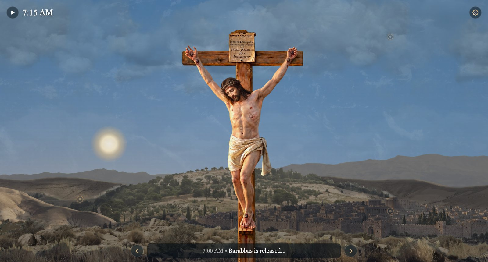
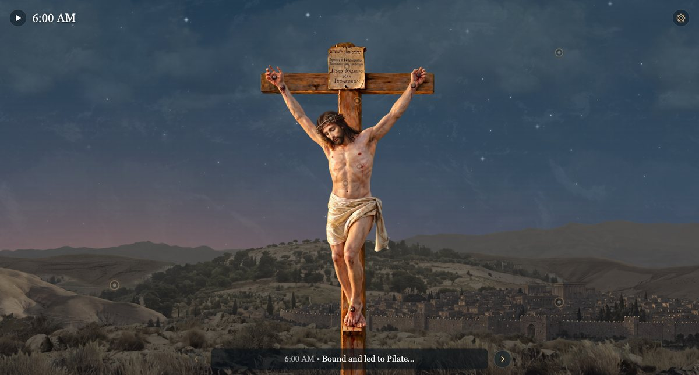
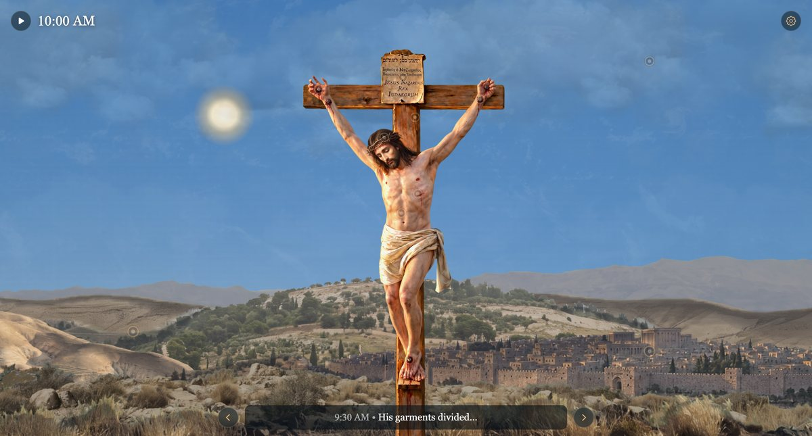
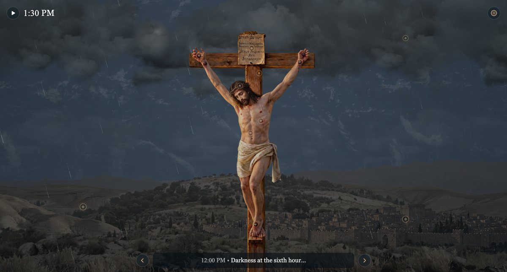
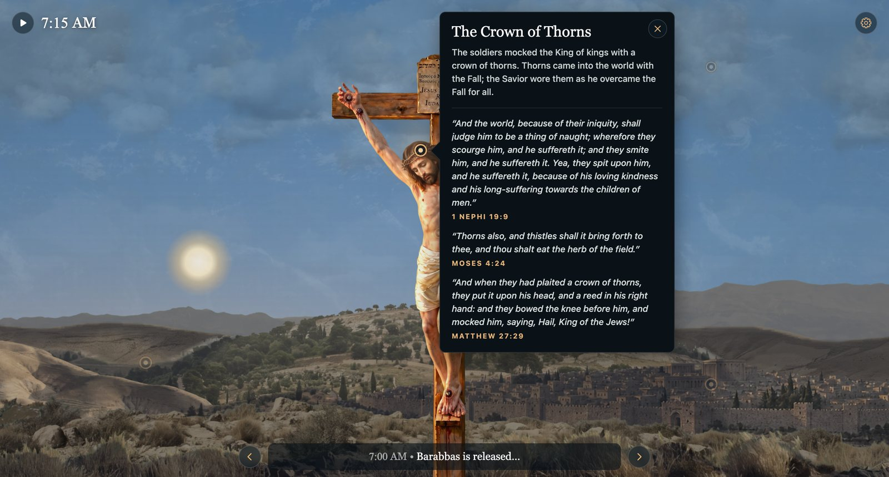
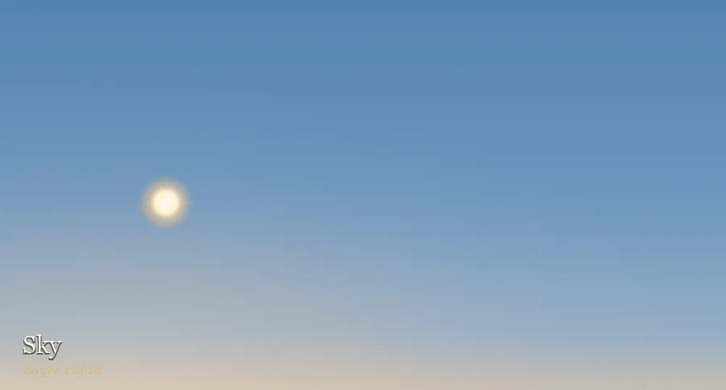

<div align="center">

# It Is Finished

### An Interactive Study of the Crucifixion

**[Open the website →](https://github.hemm.ing/closer-to-christ/)**

*A Closer to Christ Project for REL A 250: Jesus Christ and His Everlasting Gospel*
*Brigham Young University · Fall 2026 · Professor David Ridge*

<br>



</div>

<br>

## About this project

This website is my **Closer to Christ Project**, a semester-long assignment for my religion class. The assignment asks each student to create something that draws them closer to Jesus Christ, deepens their understanding of the course material, and is personally meaningful, not a hoop to jump through.

I chose to combine something I enjoy, web design, with something I wanted to understand better: the Savior's Crucifixion. The site is a living scene of Christ on the cross outside Jerusalem. It moves through the hours of that day while you read what the scriptures say happened, and explore what each part of the scene teaches.

Building it meant slowing down and studying the Crucifixion in far more detail than I normally would. Before writing anything for the site I read the accounts in Matthew, Mark, Luke and John, alongside the Book of Mormon, the Doctrine and Covenants and the Pearl of Great Price. Every piece of text on the site came out of that study.

<br>

## What you'll find

### 🕰️ The day, hour by hour

The scene runs on its own clock from **6:00 AM to 3:00 PM**, the hours from Christ's trial to His death. A caption follows the scriptural timeline through 15 events, each with its references:

| Time | Event |
|---|---|
| 6:00 AM | Bound and led to Pilate |
| 6:30 AM | Sent to Herod |
| 7:00 AM | Barabbas is released |
| 7:30 AM | Scourged and crowned with thorns |
| 8:00 AM | "Behold the man!" |
| 8:30 AM | The road to Golgotha |
| 9:00 AM | Crucified at the third hour |
| 9:30 AM | His garments divided |
| 10:15 AM | Mocked on the cross |
| 10:45 AM | "To day shalt thou be with me in paradise" |
| 11:15 AM | "Behold thy mother!" |
| 12:00 PM | Darkness at the sixth hour |
| 2:45 PM | "Why hast thou forsaken me?" |
| 2:55 PM | "It is finished" |
| 3:00 PM | The earth quakes, the veil is torn |

You can let the day play out, pause it, or jump straight to any event. Times marked *about* are ones the scriptures don't give exactly.

### 🌅 A scene that changes with the day

<table>
<tr>
<td align="center" width="33%"><br><b>6:00 AM</b><br><sub>Stars and city lamps before dawn</sub></td>
<td align="center" width="33%"><br><b>10:00 AM</b><br><sub>Full morning light</sub></td>
<td align="center" width="33%"><br><b>1:30 PM</b><br><sub>Darkness over the land</sub></td>
</tr>
</table>

- **Light:** the sun rises behind the hills, and stars and city lamps fade as morning comes. Every layer of the landscape is lit for the hour.
- **Darkness:** from noon "there was a darkness over all the earth until the ninth hour" (Luke 23:44). The day dims unnaturally and the storm builds.
- **Weather:** clouds drift with the wind, rain falls, and lightning flashes in the storm.
- **Movement:** grass and bushes sway in the wind, and the Savior's hair and loincloth move as He breathes.
- **3:00 PM:** an earthquake rolls through the land when He dies, as the Gospels and 3 Nephi 8 describe.
- **Depth:** the whole scene shifts as you move the mouse or tilt your phone.

### ✝️ Places to stop and learn

Small gold markers sit on the figure and in the landscape. Each one opens a card explaining what that detail teaches, with scriptures from the Book of Mormon, Doctrine and Covenants and Pearl of Great Price first, then the Bible.

<div align="center">

</div>

<br>

| Marker | What it teaches |
|---|---|
| **The Prints of the Nails** | He invites us to feel the prints in His hands (1 Nephi 21:16; 3 Nephi 11:14; John 20:27) |
| **A Nail in a Sure Place** | The nails in the wrists, and Isaiah's "nail in a sure place" (Mosiah 14:5; D&C 45:51–52; Isaiah 22:23) |
| **His Hands and His Feet** | The risen Lord showed His wounds as witness (3 Nephi 11:15; D&C 130:22; Luke 24:39) |
| **The Crown of Thorns** | Thorns came with the Fall; He wore them to overcome it (1 Nephi 19:9; Moses 4:24; Matthew 27:29) |
| **The Wound in His Side** | The wound He still points to as His witness (D&C 6:37; John 19:34) |
| **Father, Forgive Them** | Forgiveness offered from the cross (D&C 19:16; D&C 64:10; Luke 23:34) |
| **The King of the Jews** | The sign in Hebrew, Greek and Latin, with a picture of how it may have looked (Mosiah 3:8; John 19:19–20) |
| **Lifted Up upon the Cross** | Golgotha, and the prophecies that He would be lifted up (1 Nephi 11:33; 3 Nephi 27:14; Moses 7:55; John 19:17–18; John 12:32) |
| **The Mount of Olives** | Gethsemane, the Ascension and the Second Coming (Mosiah 3:7; D&C 19:18; D&C 45:48; Luke 22:44; Acts 1:11–12) |
| **Jerusalem** | The city He wept over (3 Nephi 10:5; Matthew 23:37; Hebrews 13:12) |
| **Darkness over the Land** | Darkness in Jerusalem, and the storm and three days of darkness in the Americas (3 Nephi 8:5–6, 20; Moses 7:56; Luke 23:44–45) |

Scriptures are quoted from the Church's editions at [churchofjesuschrist.org](https://www.churchofjesuschrist.org/study/scriptures).

### ⚙️ Settings

The gear button opens settings for the time of day, the weather (from clear skies to a full storm), the parallax movement, and the image quality.

<br>

## How it's built

<div align="center">

</div>

<br>

It's a hand-built website made with plain HTML, CSS and JavaScript, with no frameworks or libraries.

- **Layers:** the scene is a stack of layers: sky, six cloud layers, rain, distant mountains, desert hills, the Mount of Olives, Jerusalem, Golgotha's ridge, the near ground, and the figure on the cross.
- **Light and colour:** the colour of every layer is worked out from the hour and the weather, through a set of curves for daylight, warmth, darkness and storm.
- **GPU drawing:** the moving parts (swaying plants, the figure's hair, cloth and breathing, the rain) and the large still layers are drawn with WebGL in background workers. That keeps animation off the page's main thread.
- **Speed:** it was benchmarked to run smoothly in Safari, Chrome and Firefox: about 60 frames per second in Safari and 120 in Chrome and Firefox on a 120 Hz display. Slower phones automatically get a lighter version.
- **Offline cache:** a service worker keeps the images on your device, so later visits load almost instantly.

```
index.html             the page
styles.css             all the styling
service-worker.js      keeps images on the device after the first visit
js/
  utils.js             small shared helpers
  time-and-weather.js  the clock's light and weather, the sky and the sun
  loading.js           loading screen and quality levels
  sky.js               stars and shooting stars
  storm.js             clouds, rain and lightning
  land.js              the landscape, city lights, cast shadows and the earthquake
  parallax.js          movement with the mouse or phone tilt
  timeline.js          the clock, caption and list of events
  settings-panel.js    the settings panel
  teachings.js         what each marker teaches (the scriptures)
  markers.js           the markers and their cards
  workers/
    wind.js            draws the swaying and still layers on the GPU
    rain.js            draws the rain
assets/                the images
```

### Running it yourself

Any static file server works:

```bash
python3 -m http.server 8123
```

Then open [http://localhost:8123](http://localhost:8123).

<br>

## Credits

- **Scriptures:** from the standard works of The Church of Jesus Christ of Latter-day Saints, quoted from [churchofjesuschrist.org](https://www.churchofjesuschrist.org/study/scriptures).
- **Artwork:** the figure, landscape layers and sign were created with Google's Gemini image models and then cut out, colour-graded and animated in code.
- **Code:** written with help from [Claude Code](https://claude.com/claude-code), an AI coding assistant.

<br>

<div align="center">

*This is a personal school project. It is not an official website of The Church of Jesus Christ of Latter-day Saints.*

<br>

> "When Jesus therefore had received the vinegar, he said, **It is finished**: and he bowed his head, and gave up the ghost."
> — John 19:30

</div>
